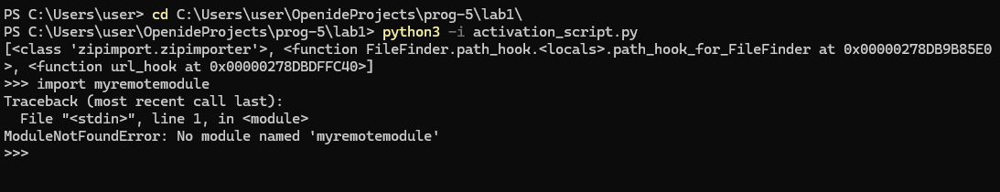
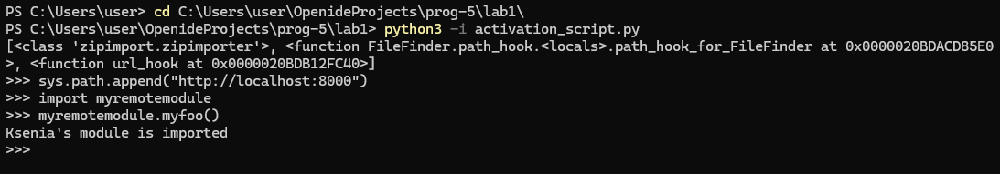
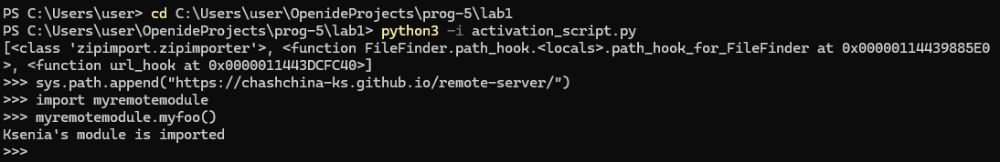
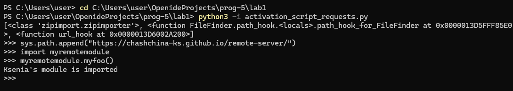
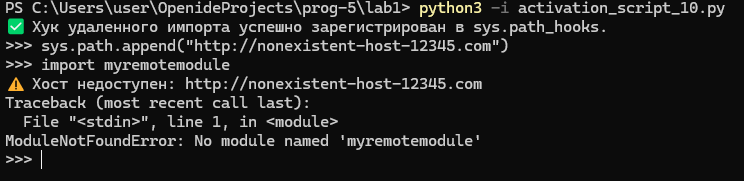
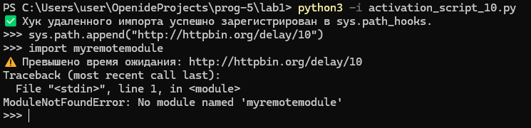
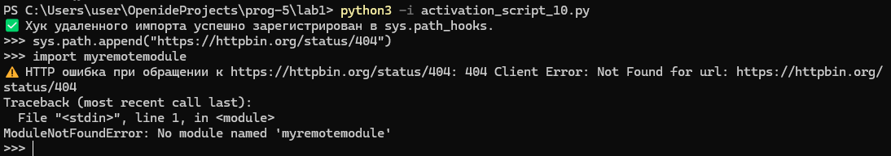
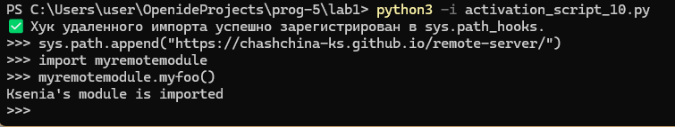

# Чащина Ксения Владимировна ИВТ-1.2

## Лабораторная работа № 1. Реализация удаленного импорта

**Цель работы:** изучить механизм импорта модулей в Python и реализовать собственный загрузчик (Loader) и поисковик (Finder), позволяющий импортировать и выполнять Python-модули напрямую с удаленного HTTP-сервера, не сохраняя их локально на диске

---

### Ход работы

#### Часть 1. Импорт с локального HTTP-сервера

Для начала была подготовлена серверная часть. В директории `rootserver` создан файл `myremotemodule.py` с тестовой функцией `myfoo()`:

```python
def myfoo():
    author = "Ksenia"
    print(f"{author}'s module is imported")
```

В файле `activation_script.py` был реализован механизм удаленного импорта с использованием стандартной библиотеки `urllib.request`

**Код файла `activation_script.py`:**

```python
import re
import sys
from urllib.request import urlopen
from importlib.abc import PathEntryFinder
from importlib.util import spec_from_loader


class URLLoader:
    def create_module(self, target):
        return None

    def exec_module(self, module):
        with urlopen(module.__spec__.origin) as page:
            source = page.read()
        code = compile(source, module.__spec__.origin, mode="exec")
        exec(code, module.__dict__)


class URLFinder(PathEntryFinder):
    def __init__(self, url, available):
        self.url = url
        self.available = available

    def find_spec(self, name, target=None):
        if name in self.available:
            origin = "{}/{}.py".format(self.url, name)
            loader = URLLoader()
            return spec_from_loader(name, loader, origin=origin)
        else:
            return None


def url_hook(some_str):
    if not some_str.startswith(("http", "https")):
        raise ImportError

    with urlopen(some_str) as page:
        data = page.read().decode("utf-8")

    filenames = re.findall(r"[a-zA-Z_][a-zA-Z0-9_]*\.py", data)
    modnames = {name[:-3] for name in filenames}

    return URLFinder(some_str, modnames)


sys.path_hooks.append(url_hook)
print(sys.path_hooks)
```

Для корректной проверки скрипт запускался из изолированной директории `lab1`, чтобы Python не мог найти модуль локально

**Результаты проверки:**
Без добавления пути в `sys.path` попытка импорта выдавала ожидаемую ошибку (что доказывает, что модуля нет локально):



После выполнения `sys.path.append("http://localhost:8000")` модуль успешно импортировался с удаленного хоста:



---

#### Часть 2. Импорт с GitHub Pages

Чтобы проверить работу механизма на реальном удаленном хостинге, был создан публичный репозиторий `remote-server` на GitHub 
В корень репозитория были добавлены:
*   `myremotemodule.py` — сам модуль
*   `index.html` — минимальная HTML-страница со ссылкой на модуль (необходима, так как GitHub Pages не отдает список файлов в виде directory listing)

В настройках репозитория был включен GitHub Pages для ветки `main`

В клиентском скрипте адрес был изменен на `https://chashchina-ks.github.io/remote-server/`
**Результат:** импорт успешно прошел по протоколу HTTPS



---

#### Часть 3. Модуль `requests`

Согласно заданию, код был переписан с использованием сторонней библиотеки `requests` вместо стандартного `urllib.request`

**Основные изменения:**
1. Метод `urlopen()` заменен на `requests.get()`, что позволило использовать атрибут `.text` для автоматического декодирования ответа
2. Добавлен вызов `response.raise_for_status()` для перехвата HTTP-ошибок (например, 404) на уровне библиотеки
3. Упрощен блок работы с контекстным менеджером `with`

**Код файла `activation_script_requests.py`:**

```python
import re
import sys
import requests
from importlib.abc import PathEntryFinder
from importlib.util import spec_from_loader


class URLLoader:
    def create_module(self, target):
        return None

    def exec_module(self, module):
        response = requests.get(module.__spec__.origin)
        source = response.text
        code = compile(source, module.__spec__.origin, mode="exec")
        exec(code, module.__dict__)


class URLFinder(PathEntryFinder):
    def __init__(self, url, available):
        self.url = url
        self.available = available

    def find_spec(self, name, target=None):
        if name in self.available:
            origin = "{}/{}.py".format(self.url, name)
            loader = URLLoader()
            return spec_from_loader(name, loader, origin=origin)
        else:
            return None


def url_hook(some_str):
    if not some_str.startswith(("http", "https")):
        raise ImportError

    response = requests.get(some_str)
    data = response.text

    filenames = re.findall(r"[a-zA-Z_][a-zA-Z0-9_]*\.py", data)
    modnames = {name[:-3] for name in filenames}

    return URLFinder(some_str, modnames)


sys.path_hooks.append(url_hook)
print(sys.path_hooks)
```

**Результат:**
Импорт с использованием `requests` также успешно сработал



---

#### Часть 4 (*). Обработка недоступности хоста

Для повышения устойчивости системы была добавлена обработка сетевых исключений

**Что реализовано:**
1. Установлен таймаут `HTTP_TIMEOUT = 5` секунд для всех HTTP-запросов, чтобы предотвратить зависание скрипта
2. Добавлена раздельная обработка типов ошибок библиотеки `requests` в функциях `url_hook` и `exec_module`:
   *   `ConnectionError` — отсутствует сетевое соединение (хост недоступен)
   *   `Timeout` — сервер не отвечает в течение заданного времени
   *   `HTTPError` — сервер вернул код ошибки (4xx, 5xx)
3. При возникновении ошибки выводится информативное сообщение (через `print`), а механизм импорта корректно прерывается

**Код файла `activation_script_10.py`:**

```python
import re
import sys
import requests
from importlib.abc import PathEntryFinder
from importlib.util import spec_from_loader

# Таймаут в секундах (чтобы программа не висела вечно, если сервер не отвечает)
HTTP_TIMEOUT = 5

class URLLoader:
    def create_module(self, target):
        return None

    def exec_module(self, module):
        try:
            response = requests.get(module.__spec__.origin, timeout=HTTP_TIMEOUT)
            response.raise_for_status()
            source_code = response.text
        except requests.exceptions.ConnectionError:
            raise ImportError(f"Не удалось подключиться к хосту: {module.__spec__.origin}")
        except requests.exceptions.Timeout:
            raise ImportError(f"Превышено время ожидания при загрузке: {module.__spec__.origin}")
        except requests.exceptions.HTTPError as e:
            raise ImportError(f"HTTP ошибка при загрузке модуля {module.__spec__.origin}: {e}")

        code = compile(source_code, module.__spec__.origin, mode="exec")
        exec(code, module.__dict__)


class URLFinder(PathEntryFinder):
    def __init__(self, url, available):
        self.url = url
        self.available = available

    def find_spec(self, name, target=None):
        if name in self.available:
            origin = "{}/{}.py".format(self.url, name)
            loader = URLLoader()
            return spec_from_loader(name, loader, origin=origin)
        return None


def url_hook(path):
    # Проверяем, начинается ли путь с http/https
    if not path.startswith(("http://", "https://")):
        raise ImportError("Этот хук обрабатывает только HTTP/HTTPS адреса")

    try:
        response = requests.get(path, timeout=HTTP_TIMEOUT)
        response.raise_for_status()
        data = response.text
    except requests.exceptions.ConnectionError:
        print(f"⚠️ Хост недоступен: {path}")
        raise ImportError(f"Нет соединения с {path}")
    except requests.exceptions.Timeout:
        print(f"⚠️ Превышено время ожидания: {path}")
        raise ImportError(f"Таймаут подключения к {path}")
    except requests.exceptions.HTTPError as e:
        print(f"⚠️ HTTP ошибка при обращении к {path}: {e}")
        raise ImportError(f"HTTP ошибка {path}")

    # Если всё ок, ищем файлы .py
    filenames = re.findall(r"[a-zA-Z_][a-zA-Z0-9_]*\.py", data)
    modnames = {name[:-3] for name in filenames}

    return URLFinder(path, modnames)


# Регистрируем хук
if url_hook not in sys.path_hooks:
    sys.path_hooks.append(url_hook)

print("✅ Хук удаленного импорта успешно зарегистрирован в sys.path_hooks.")
```

**Результаты тестирования:**
*   **Ошибка соединения (несуществующий хост):**



*   **Таймаут (медленный сервер):**



*   **HTTP-ошибка (404):**



*   **Рабочий хост (штатная работа):**


